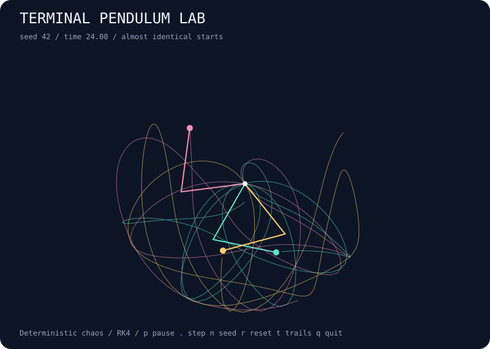

# terminal-pendulum-lab

Almost identical double pendulums diverge into colorful chaotic trails.



## Run

```bash
npx --yes github:b69ca/terminal-pendulum-lab
```

Node.js 20 or newer. No runtime dependencies. Everything runs locally.

## Play

| Key | Action |
| --- | --- |
| `p` / Space | Pause or resume |
| `.` | Pause and advance one step |
| `n` | Start the next seed |
| `r` | Reset the current seed |
| `+` / `-` | Faster or slower display |
| `q` / Ctrl-C | Quit and restore the terminal |

`--count N` selects 1–8 pendulums (default 3). `t` toggles terminal trails. One live tick advances five physics steps; `.` advances exactly one.

Live mode uses an alternate screen and restores the cursor and input mode on exit. `--no-color` or `NO_COLOR=1` disables ANSI colors. The live grid fits the terminal at startup; explicit sizes make runs reproducible across terminals. Very small terminals may clip the minimum grid.

## Export

```bash
npx --yes github:b69ca/terminal-pendulum-lab --seed 42 --steps 3000 --svg preview.svg
npx --yes github:b69ca/terminal-pendulum-lab --seed 42 --steps 3000 --json
npx --yes github:b69ca/terminal-pendulum-lab --frames 100
```

Common flags: `--seed N` (0–4294967295), `--width N` (20–120), `--height N` (10–60), `--steps N` (0–100000), `--frames N` (0–100000), `--json`, `--svg FILE`, `--no-color`, and `--help`.

Live mode begins at step zero; exports and piped output default to 3000 steps. `--steps 0` shows the initial state. JSON and SVG may be combined; neither accepts `--frames`. Piped terminal output shows at most one plain frame without escape sequences. Live frames show the starting state first, advance between frames, and count paused frames toward the limit. Exit codes: 0 success, 2 argument or file error.

## How it works

Three double pendulums start just 0.0005 radians apart. Watch deterministic motion turn into visibly different paths. Each pendulum has two equal unit masses and two unit rods. A fourth-order Runge–Kutta integrator advances by 0.008 time units; there is no friction. Colors distinguish pendulums, and numbered bobs distinguish them in plain output. JSON reports angles, angular velocities, tip separation, and absolute energy drift. Trails retain the latest 220 sampled tips. This is a numerical educational model, with finite integration error; it does not estimate a Lyapunov exponent.

## Library

Install with `npm install github:b69ca/terminal-pendulum-lab`, then:

```js
import { createWorld, step, analyze, renderSVG } from 'terminal-pendulum-lab';
const world = createWorld({ seed: 42, width: 80, height: 30 });
step(world, 3000); // Mutates and returns world.
console.log(analyze(world));
const svg = renderSVG(world);
```

Renderers and `step` accept worlds returned by `createWorld`. Keep the returned state intact. Changing dimensions or internal arrays after construction is unsupported.

## Development

```bash
npm ci
npm run check
```

Tests cover deterministic seeds, incremental updates, model invariants, bounds, render dimensions, CLI errors, and exports. GitHub Actions runs Node.js 20, 22, and 24.

## License

MIT
